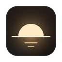
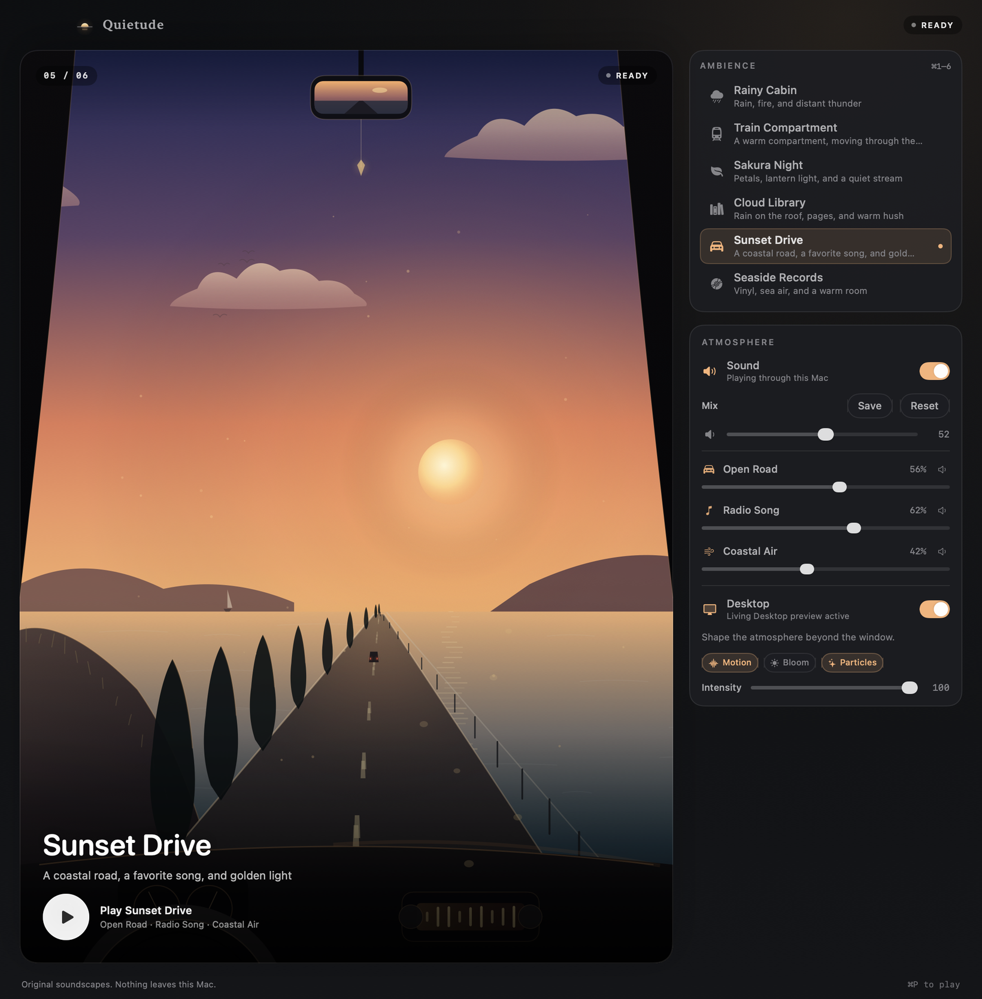
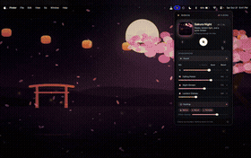

<div align="center">



# Atmora

**Six original ambiences. One quiet room.**<br>
A native macOS ambient-soundscape app: living scenes drawn in Canvas, procedural audio, and a Living Desktop — all offline, all on your Mac.




**Rainy Cabin · Train Compartment · Sakura Night · Cloud Library · Sunset Drive · Seaside Record**

[Install](#install) · [Build and run](#build-and-run) · [Environments](#environments) · [Features](#features) · [Uninstall](#uninstall)

Install in one line — builds once on this Mac (about a minute), installs to `/Applications`:

```sh
curl -fsSL https://raw.githubusercontent.com/zakhefron/atmora/main/install.sh | sh
```



</div>

---

Atmora is built with Swift 6.2, SwiftUI and AppKit, with AVFoundation for the audio graph. No
third-party packages, no web views, no accounts, no analytics, no network access — just six
original ambiences, eighteen procedural sound layers, and animated scenes drawn in `Canvas`. It
starts instantly, stays quiet until you ask for sound, and leaves your desktop exactly as it
found it.

This is the project's README. The app is ad-hoc signed (not Developer ID signed, not notarized)
and intended for local installation from source.

## Install

One line — it fetches the sources into `~/Library/Caches/Atmora`, builds once (about a
minute), and puts the app in `/Applications`. Later installs rebuild only what changed, in
seconds:

```sh
curl -fsSL https://raw.githubusercontent.com/zakhefron/atmora/main/install.sh | sh
```

There is no binary download on purpose: an app moved onto a Mac by hand arrives quarantined, and
an unsigned one is then refused by Gatekeeper ("Apple could not verify"). An app built on the
machine it lands on carries no quarantine, so it opens as itself.

> The app is **ad-hoc signed only**. On first launch, macOS may ask you to confirm it
> (right-click → **Open**). Do not disable Gatekeeper globally.

## Uninstall

Drag `Atmora.app` from `/Applications` (or `~/Applications`) to the Trash. Preferences live in
`UserDefaults` under `atmora.settings.v1` and can be removed with:

```sh
defaults delete atmora.settings.v1
```

If you installed via the local installer and want to clear the build cache:

```sh
rm -rf ~/Library/Caches/Atmora
```

## Environments

Six distinct worlds, each a complete sensory experience with original audio and animated artwork.
No two share a palette, a rhythm, or a mood.

### Rainy Cabin

A cozy wooden sanctuary during rainfall. A glowing fireplace crackles, rain drums on the roof and
window, distant thunder rolls, and a cat sleeps on the window-seat cushion.

**Layers:** Heavy Rain · Distant Thunder · Fireplace

### Train Compartment

A vintage railcar moving through the Japanese countryside at night. The rails keep their rhythm
while rice fields, mountains, villages, tunnels and bridges slide past the window. Telephone poles
and overhead wires drift by; village lights flicker in the valley below.

**Layers:** Rail Rhythm · Carriage · Distant Horn

### Sakura Night

Cherry blossoms drift over a small river under a moonlit sky. Paper lanterns glow warmly,
fireflies dance above the water, and petals fall in a sudden breeze.

**Layers:** Falling Petals · Night Stream · Lantern Chimes

### Cloud Library

A grand library floating above the clouds. Enormous arched windows look out on drifting clouds and
floating islands; warm light spills from wooden shelves, spiral staircases wind upward, and
magical particles drift in the air.

**Layers:** Window Rain · Turning Pages · Warm Hush

### Sunset Drive

A golden-hour drive along Japanese countryside roads. A first-person view from the dashboard,
winding past rice fields, coastal highways, mountain passes and illuminated streets as the sun
dips toward twilight.

**Layers:** Open Road · Radio Song · Coastal Air

### Seaside Record

A vintage seaside record shop on a wooden deck facing the ocean. A vinyl record spins gently,
waves roll in, seagulls call overhead, and a distant sailboat crosses the horizon.

**Layers:** Vinyl Warmth · Ocean Air · Faint Piano

Each environment has three independently controllable audio layers with per-layer volume and
mute. Mixes are saved per ambience and restored on relaunch.

## Features

### Immersive desktop ambience

Every scene is animated — rain falls, lanterns sway, vinyl spins, petals drift. Artwork is
rendered with SwiftUI `Canvas` at any window size; no static bitmaps are used inside the app.
Motion responds to audio playback and respects macOS Reduce Motion.

### Living Desktop

Atmora can extend the animated atmosphere beyond its own window with **Living Desktop** — a
borderless, mouse-transparent window at desktop level that sits above your wallpaper but below
Finder's desktop icons. It is an honest preview, not a system wallpaper: macOS has no public API
for third-party animated desktops, so Atmora draws its own window-level preview and leaves your
actual wallpaper untouched.

### Original procedural audio

Eighteen sound layers plus a dedicated UI click, all synthesized from scratch — forty-second
stereo AAC loops at 32 kHz with seamless, click-free looping. No field recordings, no samples, no
third-party audio.

### Menu-bar control surface

A compact popover styled like a small Apple Music panel: an animated scene thumbnail, a
now-playing card, prev / play / next controls, the full layer mix, and the Sound / Desktop
atmosphere switches. Control everything without opening the main window.

### Global shortcut

`⌥⌘Q` toggles the main window from anywhere — no Accessibility permission required. The shortcut
is fully customizable or disableable in Settings, and conflicts are reported.

### Focus timer

Start focus sessions (5 minutes to 4 hours, in five-minute steps) from the Playback menu. The
timer derives remaining time from the wall clock, so UI delays never cause drift. Optional local
notifications and sound fade-out when a session ends.

### Settings

A dedicated preferences window (**Atmora › Settings…**) covers Atmosphere (Sound / Desktop),
Sound (fade in / fade out), Appearance (theme, density, artwork motion), General (launch
behavior, login, shortcut, restore last environment), and About.

### Keyboard shortcuts

| Shortcut | Action |
|---|---|
| `⌘P` | Play / pause |
| `⌘1`–`⌘6` | Choose an ambience |
| `⌘]` / `⌘[` | Next / previous ambience |
| `⌘0` | Open the main window |
| `⌥⌘Q` | Show or hide Atmora |

Settings are opened from the macOS app menu (**Atmora › Settings…**, standard `⌘,`).

### Audio assets

Eighteen ambience layers plus a UI click, all generated by `Tools/generate_audio.py`:

- 40.000 seconds each, exactly 1,280,000 frames
- 32 kHz, stereo, AAC at 128 kbps in `.m4a`
- Equal-power tail-to-head crossfade and circular reverb for a clean loop seam
- Target RMS normalization with a peak ceiling; no compression or limiting
- Dedicated CC0 1.0 public-domain dedication (see `Assets/Audio/manifest.json`)
- A short, dry mouse click at `ui/click.m4a`, played once through its own player; excluded from
  the ambience loop crossfade

### Desktop wallpapers

Six original still wallpapers (3840×2160, JPEG quality 90), one per ambience, generated by
`Tools/generate_wallpapers.py`. Bundled as reference art; Living Desktop never writes them to the
system desktop.

---

## Build and run

Requires macOS 15 or later and the Swift toolchain (Xcode 26 or Command Line Tools).

### Development

```sh
git clone https://github.com/zakhefron/atmora.git
cd atmora
swift run Atmora
```

The app finds `Assets/Audio` through development fallbacks, so it can play from the repository
without packaging. It uses the `Atmora` preferences domain in this mode.

### Packaged app

```sh
Scripts/build_app.sh          # build, bundle, ad-hoc sign
Scripts/build_app.sh --open   # build and launch from dist/
```

The bundle is written to `dist/Atmora.app` and ad-hoc signed.

### Install locally from source

```sh
Scripts/install_app.sh --user   # ~/Applications/Atmora.app
Scripts/install_app.sh --system # /Applications/Atmora.app
```

## Checks

The Swift Testing suite runs without XCTest, so it works with Command Line Tools alone:

```sh
Scripts/test.sh
```

**78 tests in 7 suites, all passing.** They cover the ambience catalogue, bundled audio (exact
length, sample rate, channels, loop-seam integrity), focus timer, focus duration, playback
controller, preferences, and desktop atmosphere. Exits non-zero on failure.

Two release checks run from the installed bundle:

```sh
dist/Atmora.app/Contents/MacOS/Atmora --asset-check
dist/Atmora.app/Contents/MacOS/Atmora --audio-smoke-test
```

The asset check resolves the bundle's audio, wallpapers, and icon; the smoke test starts the real
`AVAudioEngine`, plays the restored ambience for six seconds, and exits 0 only if playback started
and the engine is running.

---

## Project layout

```
Sources/
├── AtmoraCore/                 # pure logic: catalogue, preferences, timer, playback,
│                                 # desktop policy, asset validation
│   ├── Models/Environment.swift  # the six ambiences and their sound layers
│   ├── Playback/PlaybackController.swift
│   ├── Preferences/PreferencesStore.swift
│   ├── Timer/FocusTimer.swift
│   └── Timer/FocusDuration.swift
└── Atmora/                     # the shipping app
    ├── App/AppCoordinator.swift  # app-level owner of state, windows, timer, menu bar
    ├── App/AtmoraApp.swift     # @main, commands, snapshot + asset checks
    ├── Audio/AudioEngineManager.swift   # AVAudioEngine graph
    ├── Audio/GlobalHotKeyManager.swift  # Carbon global shortcut
    ├── Desktop/DesktopAtmosphereController.swift
    ├── Desktop/LivingDesktopPreview.swift
    ├── UI/MainWindowView.swift   # main window: hero, rail, mixer
    ├── UI/MenuBarView.swift      # menu-bar popover
    ├── UI/SceneArtwork.swift     # all six Canvas environments
    ├── UI/SettingsView.swift     # settings window
    └── UI/Components.swift       # shared controls
Assets/
├── Audio/                        # 18 ambience layers + UI click + manifest.json
├── Wallpapers/                   # 6 × 3840×2160 JPEG stills
└── AppIcon.icns
Support/Info.plist
Scripts/
├── build_app.sh                  # builds and assembles Atmora.app
├── install_app.sh                # local installer (user or system)
└── test.sh                       # runs the Swift Testing suite
Tests/AtmoraCoreTests/          # 78 Swift Testing tests across 7 suites
Tools/
├── generate_audio.py             # procedural audio synthesis
├── generate_icon.py              # app icon generation
└── generate_wallpapers.py        # wallpaper generation
Docs/screenshots/                 # README screenshots
dist/Atmora.app                 # built, ad-hoc-signed bundle
```

## Preferences

Held in `UserDefaults` under `atmora.settings.v1`:

- `theme` — System / Dark / Light
- `launchBehavior` — main window / menu bar
- `launchAtLogin` — boolean
- `shortcut` — key combo (default `⌥⌘Q`)
- `animationEnabled` — ambient artwork motion
- `density` — Comfortable / Compact
- `fadeInSeconds` / `fadeOutSeconds` — 0 to 8 s
- `restoreLastEnvironment` — boolean
- `resumePlaybackOnLaunch` — boolean
- `soundEnabled` — Sound atmosphere switch
- `desktopMode` — Living Desktop / App Only
- `desktopAnimationEnabled` / `desktopAnimationIntensity` / `desktopEffects` — Motion, Bloom,
  Particles
- `lastFocusMinutes` — focus session length
- `stopAudioWhenTimerEnds` — boolean

Decoding is forgiving: a missing or malformed field falls back to a default instead of discarding
the whole file. Writes are debounced and flushed on quit. Nothing leaves your Mac.

---

## Known limitations

- **Living Desktop is a window-based preview, not a system wallpaper.** It draws a borderless,
  mouse-transparent window at desktop level; it does not replace your wallpaper and does not
  survive quitting the app.
- **Ad-hoc signing only.** No Developer ID certificate, no notarization. This is a local build,
  not a distribution-ready one.
- **No Intel or universal binary is checked in.** Rebuild from source on the target architecture.
- **The audio is procedural, not recorded.** It is synthesis designed for long, quiet listening,
  not a field recording.
- **There is no streaming or download fallback.** If a bundled file is missing, that ambience is
  marked unavailable; Atmora stays offline by design.

---

<div align="center">

**Atmora** — six original ambiences, one quiet room.<br>
Made by [Feroz Khan](https://github.com/zakhefron) · Audio CC0 1.0 · No source-code license chosen

</div>